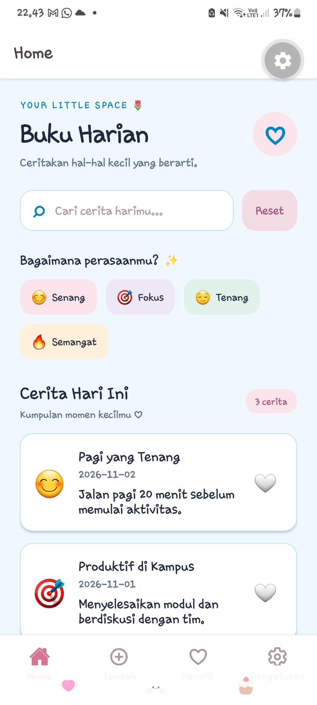
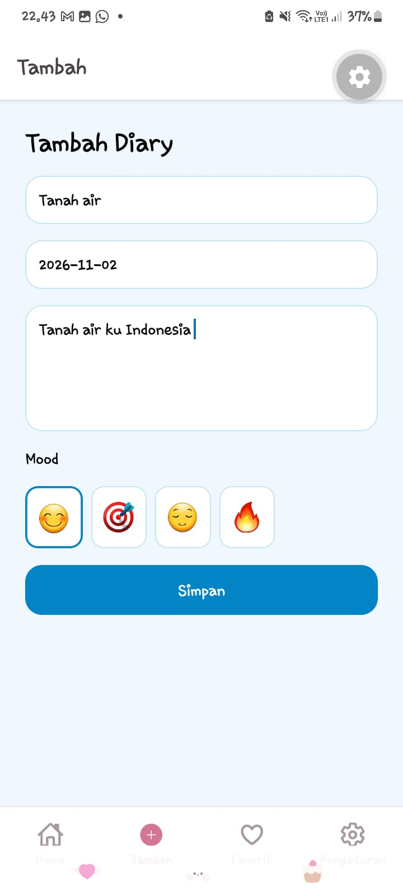
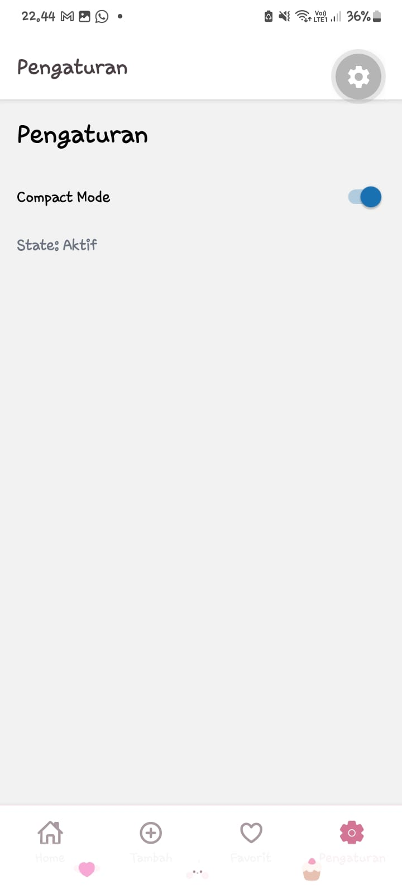

# 📘 Diary Application - Modul 6 Praktikum Pemrograman Perangkat Bergerak

Proyek aplikasi buku harian digital yang dikembangkan menggunakan **Expo Router (React Native & TypeScript)**. Aplikasi ini mengusung antarmuka bertema *soft pastel* yang estetis, dirancang untuk memudahkan pengguna dalam mendokumentasikan aktivitas harian secara interaktif. Dilengkapi dengan fitur unggulan seperti pencarian instan, filter suasana hati (*mood*), pengelolaan catatan favorit (*likes*), hingga menu pengaturan yang fleksibel.

---

## 👤 Informasi Pengembang
- **Nama Praktikan**: Yunan Ardian
- **NIM**: 2430511019
- **Kelas**: 5C

---

## ⚙️ Panduan Instalasi & Menjalankan Proyek

1. **Arahkan direktori terminal ke folder proyek**:
   ```bash
   cd diary-app6


2. **Inisialisasi server pengembangan Expo:**
    ```Bash
    npm install 
3. **Jalankan aplikasi menggunakan Expo:**
    ```Bash
    npx expo start -c

Gunakan aplikasi pendamping Expo Go pada perangkat seluler (Android/iOS) untuk memindai QR Code yang tertera di terminal, atau jalankan melalui emulator/browser . 

## 📸 Screenshots UI


Berikut adalah beberapa dokumentasi antarmuka pengguna (*User Interface*) dari aplikasi Diary:

| Beranda Utama | Pencarian Catatan | Detail Catatan |
| :---: | :---: | :---: |
|  |  |  |
| *Tampilan utama beranda yang memuat daftar seluruh catatan harian.* | *Fitur pencarian instan untuk menemukan catatan berdasarkan kata kunci.* | *Halaman baca untuk melihat isi lengkap dari catatan yang dipilih.* |

| Tambah Catatan | Daftar Favorit | Pengaturan Aplikasi |
| :---: | :---: | :---: |
|  |  |  |
| *Formulir interaktif untuk menulis dan menyimpan entri diary baru.* | *Kumpulan catatan pilihan yang telah ditandai sebagai favorit.* | *Menu pengaturan sistem serta informasi identitas pengembang.* |

## 🧩 Implementasi *React Hooks*

Berikut adalah ringkasan penggunaan *Hooks* utama yang diterapkan dalam logika pemrograman aplikasi ini:

| Jenis Hook | Peran & Implementasi dalam Sistem |
| :--- | :--- |
| **`useState`** | Berfungsi untuk menangani perubahan state komponen secara lokal, meliputi pengelolaan nilai input form, status interaksi tombol *like/favorit*, serta pembaruan daftar entri data catatan. |
| **`useEffect`** | Digunakan untuk mengeksekusi proses *side effects*, contohnya memuat data awal catatan dari penyimpanan lokal (*AsyncStorage*) saat aplikasi pertama kali dimuat (*on mount*). |
| **`useMemo`** | Berfungsi meningkatkan efisiensi kinerja aplikasi melalui teknik *memoization* pada proses penyaringan data (*filtering*) berdasarkan kata kunci atau kategori *mood*, sehingga aplikasi tetap responsif. |